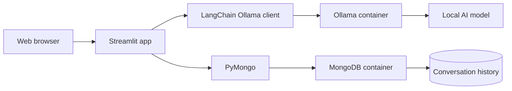

# ConvoPro — Private Local ChatGPT

ConvoPro is a local-first AI chat application built with Streamlit. It uses
Ollama to run language models on your computer and MongoDB to save conversation
history. Prompts, responses, models, and chat history remain on your machine.

## Features

- Chat with locally installed Ollama models
- Switch between available models from the sidebar
- Automatically generate a short title for every new conversation
- Save and reopen complete conversation history in MongoDB
- Keep MongoDB data and Ollama models in persistent Docker volumes
- Use a responsive dark interface designed for desktop and smaller screens
- Run without an OpenAI API key or another cloud AI service

## Technology stack

| Component | Purpose |
| --- | --- |
| Python | Application language |
| Streamlit | Web interface and session state |
| Ollama | Local model runtime |
| LangChain Ollama | Python integration with Ollama |
| MongoDB | Persistent conversation storage |
| PyMongo | MongoDB Python driver |
| Docker Compose | Local MongoDB and Ollama services |
| Pydantic Settings | Environment configuration |

## Architecture



The Streamlit application runs on the host machine. It connects to Ollama at
`http://localhost:11434` and MongoDB at `mongodb://localhost:27017/`.

## Project structure

```text
convoPro-private-chatgpt/
├── .streamlit/
│   └── config.toml             # Streamlit theme and browser settings
├── config/
│   └── settings.py             # Environment variable settings
├── db/
│   ├── mongo.py                # Shared MongoDB connection
│   └── conversations.py        # Conversation persistence operations
├── llm_factory/
│   └── get_llm.py              # Cached LangChain Ollama client
├── services/
│   ├── get_models_list.py      # Fetch installed Ollama models
│   └── get_title.py            # Generate conversation titles
├── compose.yaml                # MongoDB and Ollama containers
├── env_template.txt            # Environment variable template
├── main.py                     # Streamlit application
├── requirements.txt            # Python dependencies
└── README.md
```

## Prerequisites

Install the following before starting:

- Python 3.11 or newer
- Docker Desktop with Docker Compose
- Git, if you are cloning the repository
- At least several gigabytes of free storage for Docker images and AI models

The exact memory and storage requirement depends on the selected Ollama model.
`gemma2:2b` is the recommended starter model because it is relatively small.

## Quick start on Windows

### 1. Open the project

```powershell
cd "C:\Users\Lovely Gupta\PycharmProjects\convoPro-private-chatgpt"
```

If you are starting from a remote repository instead, clone it first and then
enter its directory:

```powershell
git clone <repository-url>
cd convoPro-private-chatgpt
```

### 2. Create the environment file

```powershell
Copy-Item env_template.txt .env
```

The default configuration is:

```dotenv
MONGODB_DB_URL="mongodb://localhost:27017/"
MONGODB_DB_NAME="chat_data"
OLLAMA_URL="http://localhost:11434"
OLLAMA_MODELS="gemma2:2b,llama3:latest,mistral:7b"
```

`OLLAMA_MODELS` documents the models you may want to use. The application
sidebar shows models that are actually installed on the connected Ollama
server.

### 3. Create and activate a virtual environment

```powershell
python -m venv .venv
.\.venv\Scripts\Activate.ps1
```

If PowerShell blocks virtual-environment activation, run this once in the same
terminal and try again:

```powershell
Set-ExecutionPolicy -Scope Process -ExecutionPolicy Bypass
```

### 4. Install Python dependencies

```powershell
python -m pip install --upgrade pip
pip install -r requirements.txt
```

### 5. Start MongoDB and Ollama

Make sure Docker Desktop is running, then execute:

```powershell
docker compose up -d
docker compose ps
```

The expected containers are:

- `convopro-mongodb` on port `27017`
- `convopro-ollama` on port `11434`

### 6. Download an Ollama model

```powershell
docker compose exec ollama ollama pull gemma2:2b
```

Confirm that the model is installed:

```powershell
docker compose exec ollama ollama list
```

Additional examples:

```powershell
docker compose exec ollama ollama pull llama3:latest
docker compose exec ollama ollama pull mistral:7b
```

Only download models that your computer has enough memory and storage to run.

### 7. Start ConvoPro

```powershell
streamlit run main.py
```

Open [http://localhost:8501](http://localhost:8501) if Streamlit does not open
the browser automatically.

On Streamlit's first-run email prompt, you can leave the email field blank and
press Enter.

## How to use the application

1. Select an installed model from **Local model** in the sidebar.
2. Enter a message in the chat input.
3. ConvoPro generates a title from the first message and creates a MongoDB
   conversation.
4. User and assistant messages are saved after each response.
5. Select a conversation under **Recent chats** to reopen it.
6. Select **New conversation** to begin a separate chat.

## Environment variables

| Variable | Required | Description | Default example |
| --- | --- | --- | --- |
| `MONGODB_DB_URL` | Yes | MongoDB connection string | `mongodb://localhost:27017/` |
| `MONGODB_DB_NAME` | Yes | Database used for chat data | `chat_data` |
| `OLLAMA_URL` | Yes | Ollama API base URL | `http://localhost:11434` |
| `OLLAMA_MODELS` | Yes | Comma-separated configured model names | `gemma2:2b,llama3:latest,mistral:7b` |

Do not commit `.env`. It is already excluded by `.gitignore`.

## MongoDB storage

Conversations are stored in the `conversations` collection inside the database
configured by `MONGODB_DB_NAME`.

Example document:

```json
{
  "_id": "8f5e2ef4-6f43-4ac6-a024-8b873977777f",
  "title": "Introduction to Machine Learning",
  "messages": [
    {
      "role": "user",
      "content": "What is machine learning?",
      "ts": "UTC datetime"
    },
    {
      "role": "assistant",
      "content": "Machine learning is...",
      "ts": "UTC datetime"
    }
  ],
  "last_interacted": "UTC datetime"
}
```

### View data with MongoDB Compass

1. Open MongoDB Compass.
2. Connect with `mongodb://localhost:27017/`.
3. Open the `chat_data` database, or the name configured in `.env`.
4. Open the `conversations` collection.

MongoDB does not show the application database or collection until the first
conversation has been created. Send at least one message in ConvoPro, wait for
the response to be saved, and then refresh Compass.

## Docker data and lifecycle

The Compose configuration uses two named volumes:

- `convopro_mongodb_data` stores MongoDB data
- `convopro_ollama_data` stores downloaded Ollama models

Stop and remove the containers while preserving data:

```powershell
docker compose down
```

Start them again:

```powershell
docker compose up -d
```

View logs:

```powershell
docker compose logs -f mongodb
docker compose logs -f ollama
```

Restart one service:

```powershell
docker compose restart mongodb
docker compose restart ollama
```

> **Warning:** `docker compose down -v` deletes the MongoDB and Ollama volumes.
> This removes saved chat history and downloaded models.

## Useful health checks

Check MongoDB from inside its container:

```powershell
docker compose exec mongodb mongosh --quiet --eval "db.adminCommand('ping')"
```

Check the Ollama API:

```powershell
Invoke-RestMethod http://localhost:11434/api/tags
```

Test a model directly:

```powershell
docker compose exec ollama ollama run gemma2:2b "Say hello in one sentence."
```

Check the Python files for syntax errors:

```powershell
python -m py_compile main.py config\settings.py db\mongo.py db\conversations.py services\get_models_list.py services\get_title.py llm_factory\get_llm.py
```

## Troubleshooting

### Streamlit asks for an email address

This is Streamlit's optional first-run prompt. Leave the field blank and press
Enter. The project also disables usage-stat collection in
`.streamlit/config.toml`.

### `Could not connect to Ollama`

Check the container and logs:

```powershell
docker compose ps
docker compose logs ollama
```

Also verify that `OLLAMA_URL=http://localhost:11434` in `.env`.

### The model list is empty

The container is running, but no model is installed. Pull one and refresh the
application:

```powershell
docker compose exec ollama ollama pull gemma2:2b
```

### `model not found`

Confirm the exact model name:

```powershell
docker compose exec ollama ollama list
```

Use the complete name including its tag, such as `gemma2:2b`.

### MongoDB is connected but no data appears

- Send a message and wait for the assistant response.
- Refresh MongoDB Compass.
- Open the database named by `MONGODB_DB_NAME`.
- Open the `conversations` collection.
- Make sure Compass is connected to `mongodb://localhost:27017/`.

### The MongoDB container is not visible in Docker Desktop

Turn off Docker Desktop's **Only show running containers** filter and run:

```powershell
docker compose up -d mongodb
docker compose ps -a
```

If it exited, inspect its logs:

```powershell
docker compose logs mongodb
```

### Port `27017`, `11434`, or `8501` is already in use

Find the process using a port:

```powershell
Get-NetTCPConnection -LocalPort 27017,11434,8501 -ErrorAction SilentlyContinue
```

Stop the conflicting service or change the relevant port mapping and matching
environment URL.

### UI changes do not appear

Stop Streamlit with `Ctrl+C` and start it again:

```powershell
streamlit run main.py
```

Theme changes in `.streamlit/config.toml` require a restart.

### Responses are slow

Local inference speed depends on model size, available RAM, CPU, and GPU
configuration. Start with `gemma2:2b`, close memory-heavy applications, and
avoid downloading or running a model larger than your hardware can support.

## Privacy and security notes

- AI inference and chat storage are local in the default configuration.
- The app does not require a cloud API key.
- MongoDB and Ollama ports are published to the host for local development.
- The default MongoDB container has no username or password and should not be
  exposed to the public internet.
- If you change `OLLAMA_URL` or `MONGODB_DB_URL` to remote services, data will no
  longer remain entirely on this computer.

## Development notes

- `get_ollama_llm()` caches the most recently selected model client.
- `get_models_list()` reads the models installed on the live Ollama server.
- `get_title()` falls back to text from the first user message if title
  generation fails.
- Conversation IDs are UUIDs and timestamps are timezone-aware UTC values.
- Opening an existing conversation updates its `last_interacted` timestamp, so
  recent chats are ordered by the latest interaction.

## Stopping the project

Stop Streamlit with `Ctrl+C`, then optionally stop the containers:

```powershell
docker compose down
```

Your conversation history and downloaded models remain available in Docker
volumes for the next run.

## License

No license file is currently included. Add a license before redistributing the
project or accepting external contributions.
